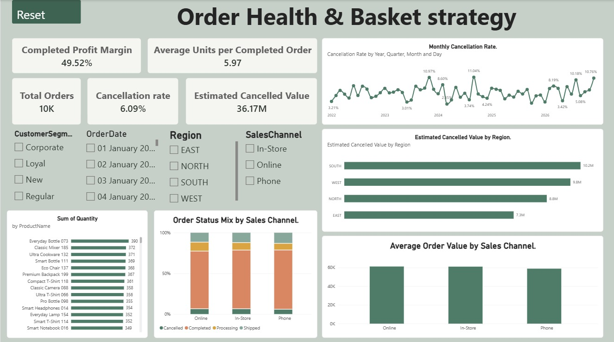

# Retail Sales Analysis

An end-to-end retail analytics portfolio project using Excel, Python, Google Colab, Seaborn, and Power BI. The project explores eight related retail datasets, answers 21 assigned business questions, and adds independent analysis of customer, product, order, store, and return patterns.

## Project overview

- **Business area:** retail sales performance, order health, and basket strategy
- **Data:** eight CSV files covering customers, employees, orders, order items, products, returns, stores, and targets
- **Tools:** Microsoft Excel, Python, pandas, Seaborn, Google Colab, and Microsoft Power BI
- **Deliverables:** Excel analysis, Colab notebooks, charts, a five-page Power BI report, and a custom Power BI theme

## Power BI dashboard

The report contains five pages:

1. **Executive Overview** — high-level retail sales performance
2. **Products & Employees** — product and employee performance
3. **Customers & Stores** — customer and store analysis
4. **Returns & Targets** — return patterns and target achievement
5. **Order Health & Basket Strategy** — order status, cancellations, regional exposure, sales channels, and product demand

The Order Health & Basket Strategy page includes KPI cards for total orders, cancellation rate, estimated cancelled value, average units per completed order, and completed profit margin. Its charts explore monthly cancellation rate, estimated cancelled value by region, order status by sales channel, average order value by sales channel, and top products by units sold.

> Estimated cancelled value is an estimate based on order-item and product data. It should not be interpreted as actual completed revenue.

### Power BI dashboard screenshot



The `.pbix` file is not currently listed in the repository. Add it if you want visitors to open and interact with the report in Power BI Desktop.

## Custom Power BI theme

The repository includes a light **Sage and Terracotta** theme with a warm off-white canvas and muted green, terracotta, gold, and rose chart colors.

- **Theme file:** [`Retail_Sage_Terracotta_Theme.json`](Retail_Sage_Terracotta_Theme.json)
- **Apply it:** In Power BI Desktop, choose **Design → Import theme**, then select the JSON file.
- Individual formatting applied directly to a visual can take precedence over theme defaults. Recolor those visuals manually if needed.

## Seaborn and analysis charts

The following charts are exported from the Order Health and Basket Strategy notebook:

### Order health and sales channels
## Seaborn and analysis charts

The following charts are exported from the Order Health and Basket Strategy notebook.

### Order health and sales channels


### Basket and product analysis


### Sales and customer analysis


These charts describe patterns in the supplied dataset; they do not, by themselves, establish that one factor caused another. Category names should be standardized before interpreting category-level comparisons.

## Independent analysis questions

The project also explores these questions using the supplied data:

1. How does revenue vary by day of the week?
2. Do customer age groups prefer different product categories?
3. Which payment methods are used most, and which are associated with the most revenue?
4. Are larger discounts associated with more units sold?
5. Which suppliers contribute the most revenue and profit?
6. How many days pass between a product launch and its first sale?
7. Do long-time customers spend more than newer customers?
8. Which customer cities have the most orders and highest average order value?
9. Are return reasons more common for particular product categories?
10. Is employee salary associated with revenue generated?

The repository includes supporting charts for these questions. The salary and revenue comparison is exploratory; an association does not show that salary causes revenue.

## Excel analysis

The Excel workbook answers 21 assigned sales-performance questions. Topics include revenue, profit, quantity sold, monthly sales, regions, products, employees, customers, stores, sales channels, returns, and targets.

[Open the Excel workbook](Sales_Performance_Analysis.xlsx.xlsx)

## Data files

The project uses these eight CSV files:

- `customers.csv`
- `employees.csv`
- `order_items.csv`
- `orders.csv`
- `products.csv`
- `returns.csv`
- `stores.csv`
- `targets.csv`

Before sharing the repository publicly, confirm that customer and employee data are synthetic or approved for public release. Do not publish real customer email addresses, confidential salary information, or other personally identifiable or confidential data.

## Repository contents

```text
retail-sales-analysis/
├── README.md
├── Retail_Sage_Terracotta_Theme.json
├── Pandas_Retail_Sales_Operations1.ipynb
├── Own_Questions_Retail_Sales_Analysis.ipynb
├── notebooks/
│   └── Order_Health_and_Basket_Strategy.ipynb - Colab.html
├── screenshots/
│   ├── Screenshot 2026-11-23 154004.png
│   ├── image1.png
│   ├── image2.png
│   ├── img3.png
│   ├── imag4.png
│   ├── imag5.png
│   ├── imag6.png
│   ├── imag7.png
│   └── imag8.png
├── Sales_Performance_Analysis.xlsx.xlsx
├── customers.csv
├── employees.csv
├── order_items.csv
├── orders.csv
├── products.csv
├── returns.csv
├── stores.csv
└── targets.csv
```

The tree above shows the recommended locations for the new theme, HTML export, and screenshots. Keep the links in this README aligned with the locations you upload to GitHub.

## How to use

- Open the Excel workbook in Excel to review the analysis and summaries.
- Open `.ipynb` notebooks in Google Colab or Jupyter. In Colab, upload the required CSV files when prompted.
- View the static HTML notebook export in a browser, or open the source `.ipynb` in Colab to run it.
- Import the Power BI theme from the **Design** tab in Power BI Desktop.
- Open the `.pbix` file in Power BI Desktop if it is added to the repository. When refreshing on another computer, update the data source paths as needed.

## Limitations

- Findings describe the supplied dataset and depend on the metric definitions used in each analysis.
- A relationship or correlation in a chart does not prove causation.
- The employee salary and revenue comparison is exploratory and should only be shared if the data is approved for that use.
- Confirm discount, sales, profit, return-rate, and target definitions before presenting them as official business metrics.
